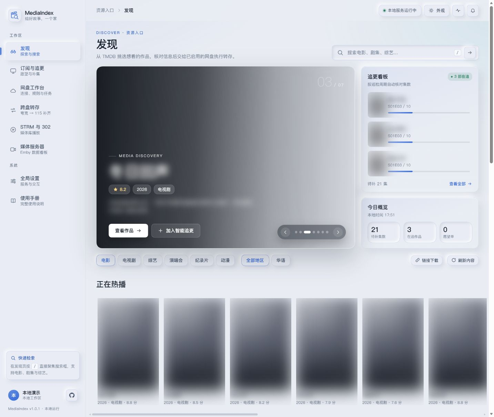
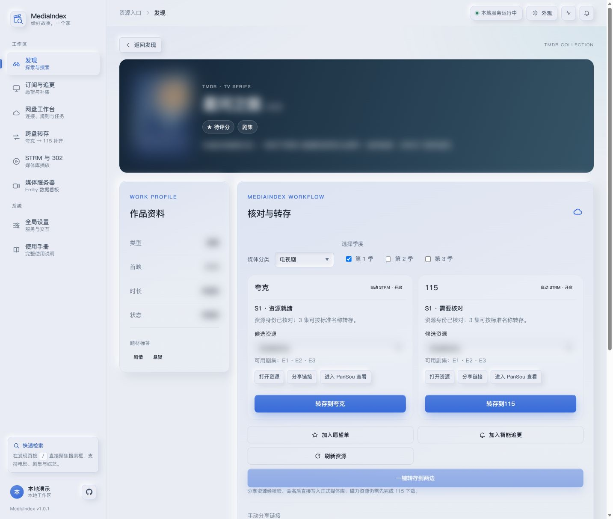
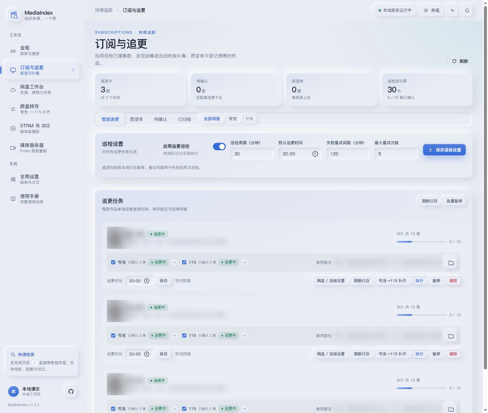
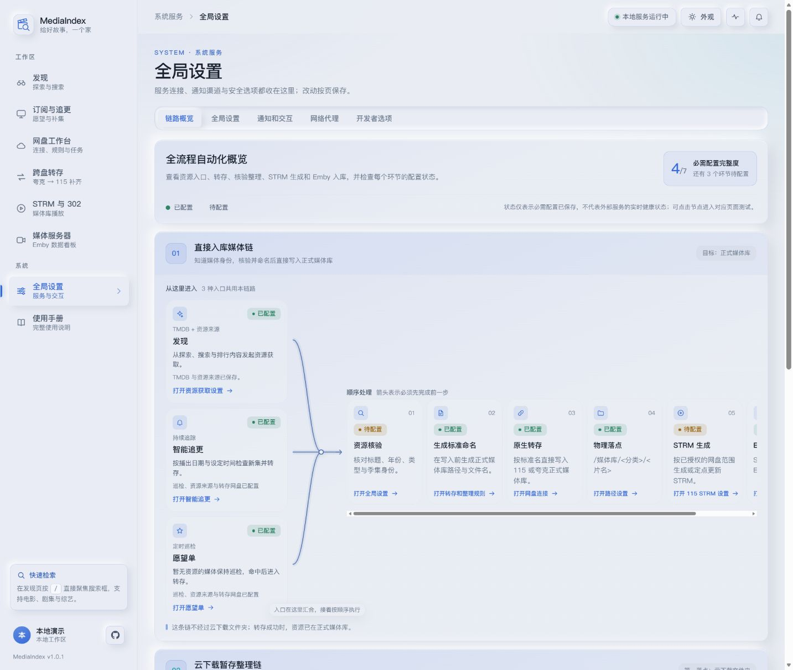
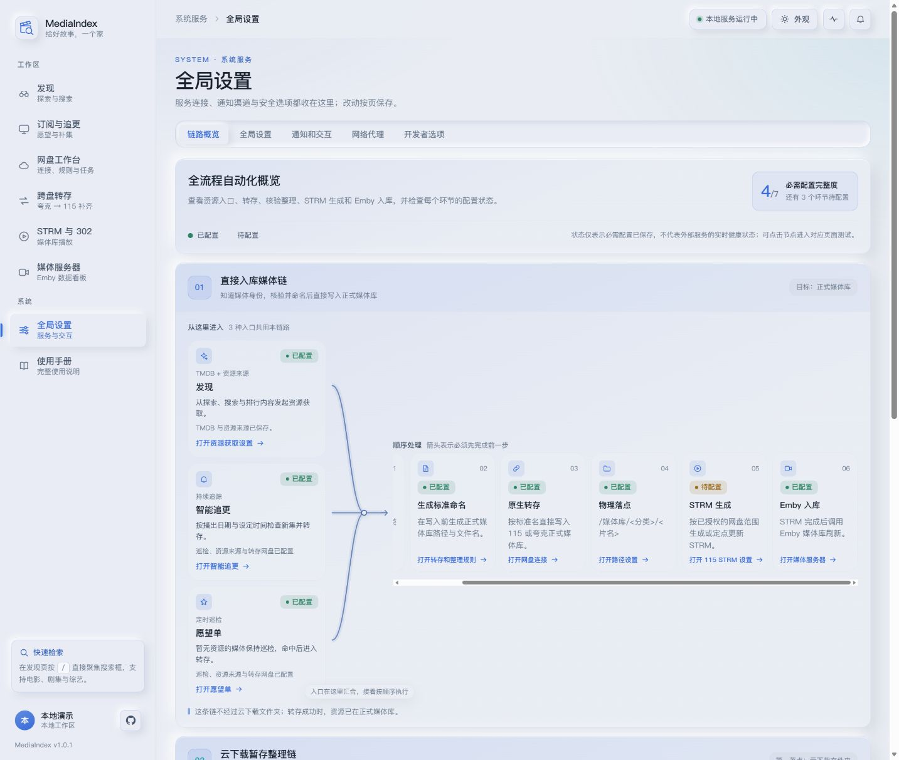
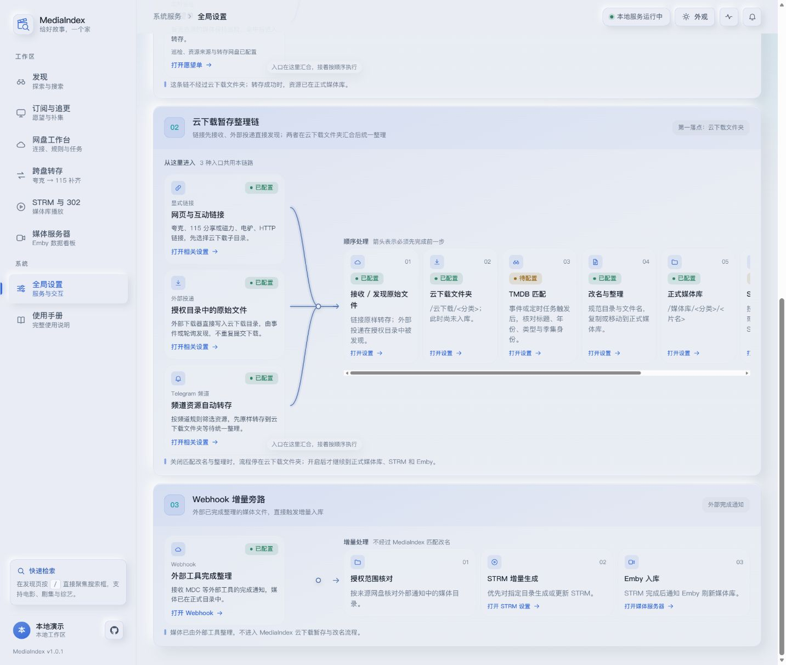
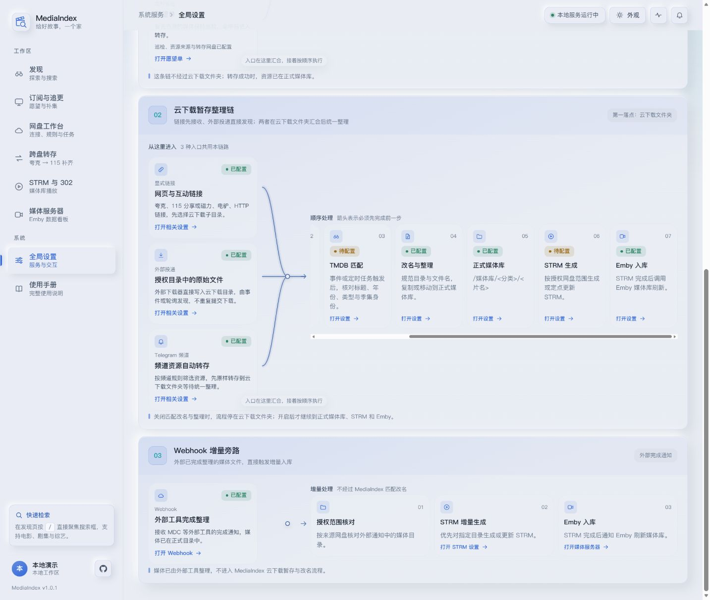

# MediaIndex

面向个人 NAS 的网盘媒体自动化中心。连接夸克、115、TMDB、PanSou 和 Emby，把发现与搜索、资源核验、转存整理、智能追更、STRM/302 播放及通知串起来。

**这里是公开部署仓库**，提供 Docker Compose、使用说明和界面截图。应用源码保持私有，运行镜像公开，部署时无需访问源码仓库或登录 GitHub。

- [下载 Docker Compose](docker-compose.yaml)
- [公开镜像](https://github.com/users/xudong7587/packages/container/package/media-index)
- [问题反馈](https://github.com/xudong7587/media-index-deploy/issues)

## 快速获取部署文件

需要 Docker 和 Docker Compose v2。支持 AMD64 与 ARM64（64 位 ARM），不支持 32 位 ARM。

```sh
mkdir -p media-index
cd media-index
curl -fL https://raw.githubusercontent.com/xudong7587/media-index-deploy/main/docker-compose.yaml -o docker-compose.yaml
```

也可以直接下载本仓库的 [docker-compose.yaml](docker-compose.yaml)，通过绿联、飞牛、群晖等 NAS 的 Compose 项目管理界面导入。

## 安装

1. 下载本目录的 `docker-compose.yaml`，放到 NAS 上准备好的项目目录。
2. 在文件中修改 `MEDIA_USER` 和 `MEDIA_PASS`，并按实际目录调整卷挂载；登录密码不要使用示例值。
3. 在项目目录执行：

```sh
docker compose up -d
```

管理页面为 `http://NAS地址:8000`；8097 为 STRM/302 播放入口。首次登录后，在网页中配置网盘、PanSou、媒体服务器和通知等服务。Compose 文件末尾附有可选 PanSou 服务模板。

| 目录 | 用途 |
| --- | --- |
| `./data` → `/app/data` | 数据库、网页配置、缓存等持久化数据 |
| `./downloads` → `/downloads` | 本地下载目录 |
| `./strm` → `/strm` | STRM 输出目录，应对应 Emby 实际扫描的位置 |

如果 NAS 目录有指定的所属用户，在项目 `.env` 中填写对应的 `PUID`、`PGID`；可参考 [.env.example](.env.example)。默认均为 `10001`。端口冲突时只修改映射左侧，保留容器内的 8000、8097。

## 第一次使用

- 在全局设置中填写自己的 TMDB API Key，获取海报、详情和季集资料。
- 连接夸克或 115，确认授权目录、保存位置与分类规则。
- 需要搜索时配置 PanSou；需要媒体库播放时配置 STRM 和 Emby；企业微信、Telegram、OpenList 等服务按需启用。
- 先手动核对一项资源的路径和执行结果，再开启自动任务。完整功能说明可从应用内的“使用手册”查看。

第三方服务账号、API Key 和网盘凭据由你自行准备，在自己的部署中填写。

## 更新

```sh
docker compose pull
docker compose up -d
```

镜像地址继续使用 `ghcr.io/xudong7587/media-index:latest`。公开镜像支持匿名拉取，无需取得源码仓库权限，也无需提供 GitHub 账号或令牌。支持 AMD64 与 ARM64。

保留 `data`、`downloads` 和 `strm` 的原挂载路径，更新前备份 `data` 目录。

已有用户可以继续使用原来的 Compose 和挂载目录，不必重新导入项目。`latest` 用于跟随正式镜像更新；需要固定版本时，将镜像标签换成对应的已发布版本标签。

## 主要能力

- 通过 TMDB、PanSou 和网盘候选核对媒体身份与可用集数。
- 夸克与 115 分别设置连接、目录、转存和 STRM，按需选择目标网盘。
- 在授权范围内整理云下载、分类命名，不确定的结果保留待确认。
- 使用智能追更和愿望单等待资源、观察连载更新并检查缺集。
- 生成 STRM/302 播放入口，连接 Emby 媒体库、封面与相关任务。
- 查看执行进度和失败原因，按需接入企业微信或 Telegram 通知。

## 界面示例

以下为 v1.0.1 界面和隔离演示数据。海报、媒体名称、剧情及含媒体名称的路径均已做高斯模糊。

| 发现与搜索 | 媒体详情与资源核验 |
| --- | --- |
|  |  |

<details>
<summary>订阅与追更</summary>



</details>

<details>
<summary>直接入库流程</summary>

| 入口与核验 | 媒体库输出 |
| --- | --- |
|  |  |

</details>

<details>
<summary>云下载暂存整理流程</summary>

| 暂存与匹配 | 整理后的输出 |
| --- | --- |
|  |  |

</details>

## 常见问题

- `No code object available for app.combined_server`：v1.0.2 的升级启动兼容问题已在 v1.0.3 修复，请重新拉取 `latest` 并重建容器。
- 拉取时出现 `EOF` 或 DNS 解析错误：先检查 Docker 宿主机到 `ghcr.io` 的连接及其 DNS/代理配置。Compose 中的代理环境变量用于容器内应用，并不等于 Docker 服务已配置镜像拉取代理。

公开镜像权限说明：[GitHub Container registry](https://docs.github.com/en/packages/working-with-a-github-packages-registry/working-with-the-container-registry)。Docker 镜像拉取代理说明：[Docker daemon proxy configuration](https://docs.docker.com/engine/daemon/proxy/)。

## 反馈问题

请通过 [Issues](https://github.com/xudong7587/media-index-deploy/issues) 提供 NAS 系统、CPU 架构、应用版本、复现步骤和相关日志。发送前隐藏 Cookie、Token、密码和私人分享链接。

本仓库不提供影视资源、分享链接或第三方账号。
